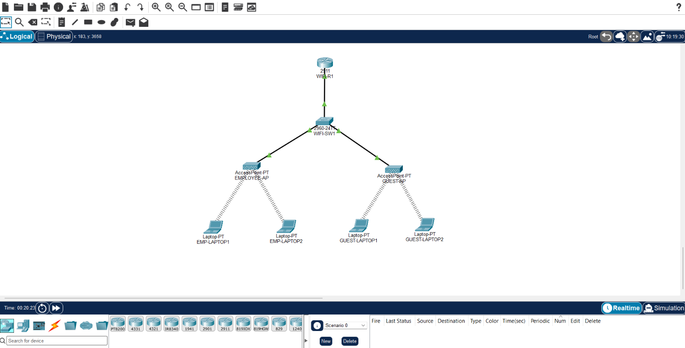
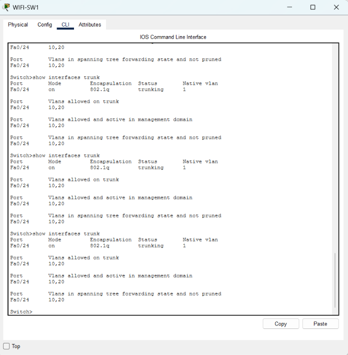
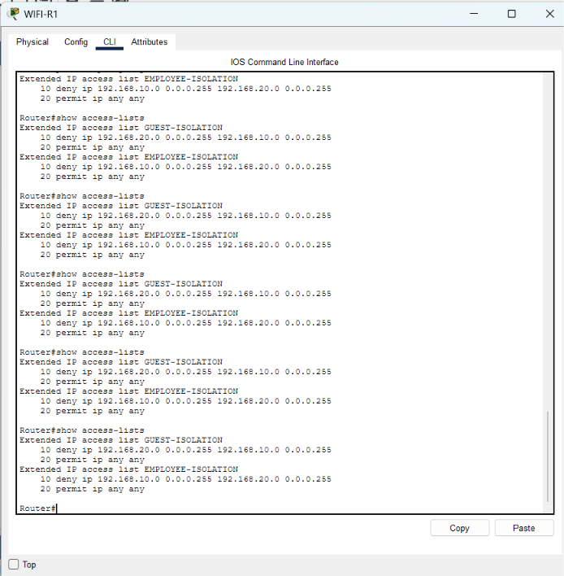

# Enterprise Wireless Network with Guest Wi-Fi

## Project Overview

This project demonstrates an enterprise wireless network designed using Cisco Packet Tracer. It provides separate wireless networks for employees and guests using VLAN segmentation, router-on-a-stick inter-VLAN routing, and Access Control Lists (ACLs) for network isolation.

## Network Topology

The network consists of:

- 1 Cisco Router (WIFI-R1)
- 1 Cisco 2960 Switch (WIFI-SW1)
- 2 Wireless Access Points (EMPLOYEE-AP and GUEST-AP)
- 2 Employee Laptops
- 2 Guest Laptops

## Technologies and Concepts

- Cisco Packet Tracer
- VLAN Configuration
- VLAN Trunking (802.1Q)
- Router-on-a-Stick
- Wireless SSID Configuration
- WPA2-PSK Security
- IPv4 Addressing
- Extended Access Control Lists (ACLs)
- Network Segmentation and Isolation

## IP Addressing Plan

| Network | VLAN | Subnet | Default Gateway |
|---|---|---|---|
| Employee | 10 | 192.168.10.0/24 | 192.168.10.1 |
| Guest | 20 | 192.168.20.0/24 | 192.168.20.1 |

## Wireless Network Configuration

**Employee Network**
- SSID: EMPLOYEE_WIFI
- Security: WPA2-PSK

**Guest Network**
- SSID: GUEST_WIFI
- Security: WPA2-PSK

## VLAN Configuration

- VLAN 10 - EMPLOYEE
- VLAN 20 - GUEST
- Access ports assigned to their respective VLANs.
- Trunk link configured between the switch and router.
- 802.1Q trunking enabled.
- VLANs 10 and 20 allowed on the trunk.

## Inter-VLAN Routing

Router-on-a-stick was configured using router subinterfaces.

- GigabitEthernet0/0.10 - 192.168.10.1/24
- GigabitEthernet0/0.20 - 192.168.20.1/24

## Network Security

Extended ACLs were configured to isolate the employee and guest networks.

- Guest devices cannot communicate with the employee network.
- Employee devices cannot communicate with the guest network.
- Devices within the same VLAN can communicate.
- Both networks can access their respective default gateways.

## Testing and Verification

The following connectivity and security tests were successfully completed:

- Employee-to-employee communication: Successful
- Guest-to-guest communication: Successful
- Employee-to-guest communication: Blocked
- Guest-to-employee communication: Blocked
- Employee gateway connectivity: Successful
- Guest gateway connectivity: Successful

## Project Screenshots

### 1. Network Topology

### 2. VLAN and Trunk Configuration

### 3. ACL Security Configuration

## Project Outcome

Successfully implemented an enterprise wireless network with separate employee and guest networks using VLAN segmentation, inter-VLAN routing, WPA2 wireless security, and ACL-based network isolation in Cisco Packet Tracer.
